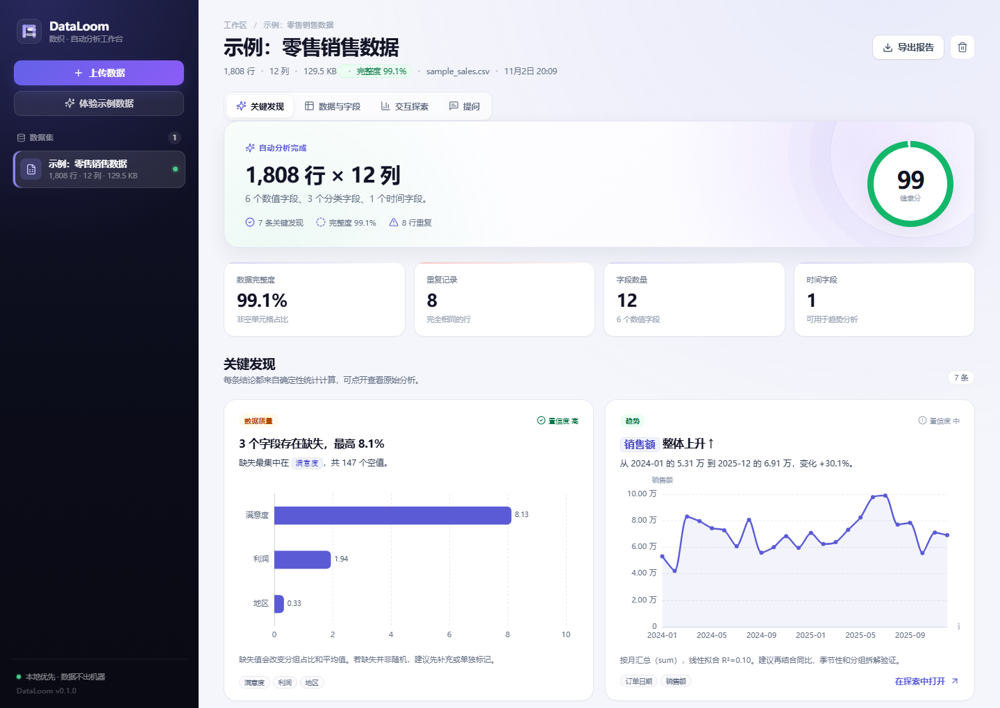
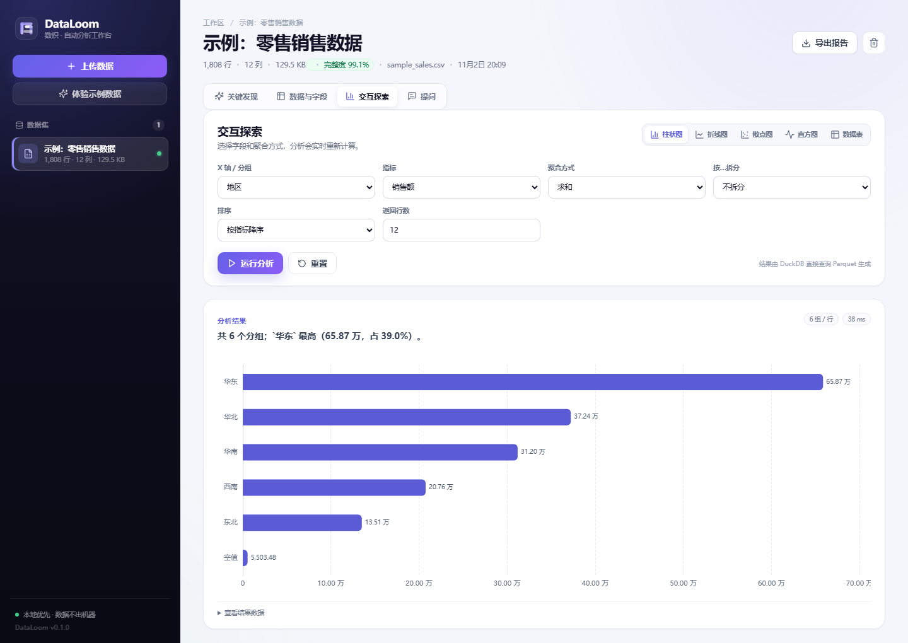
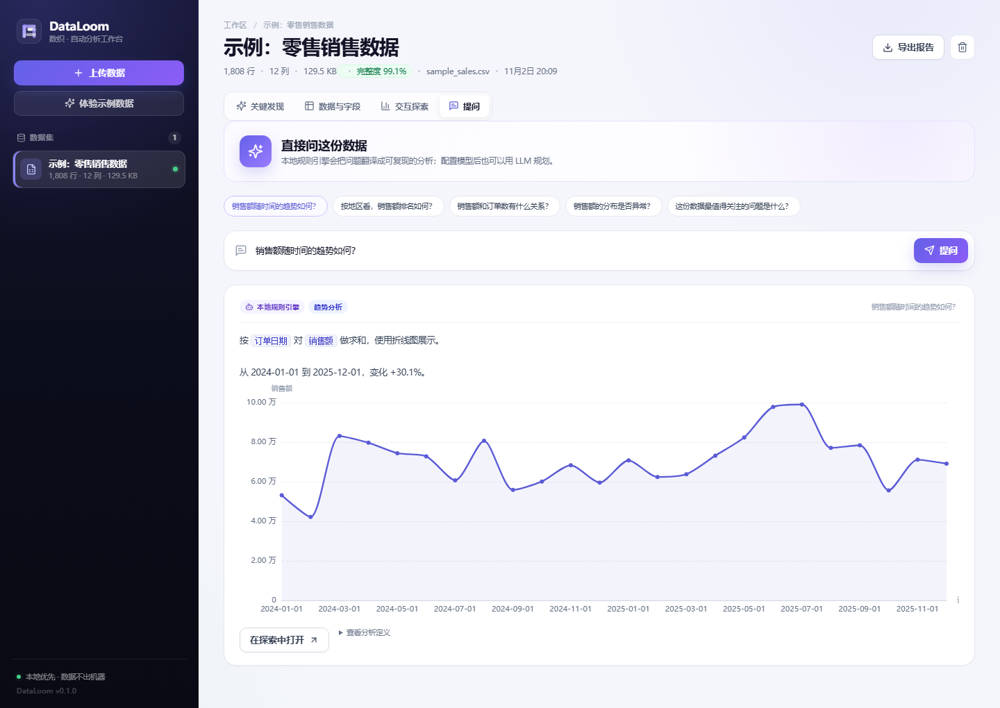
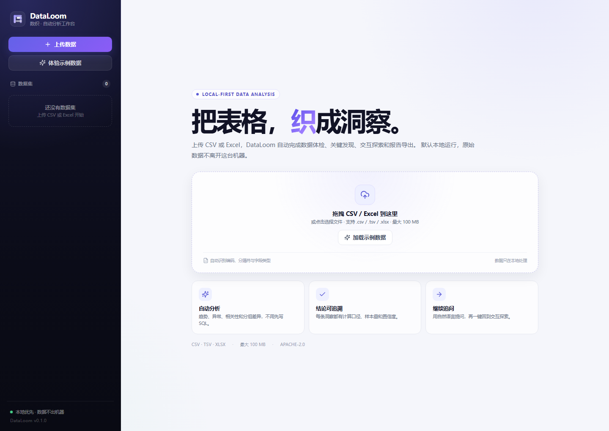
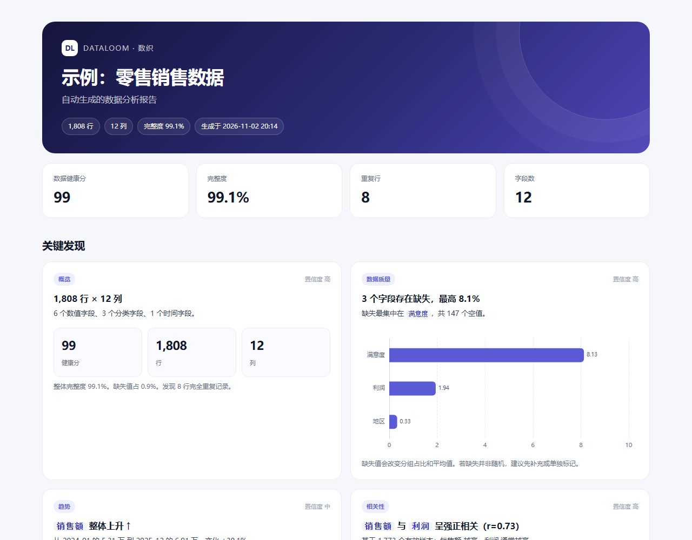
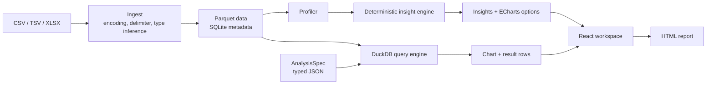

<div align="center">
  
  <h1>DataLoom · 数织</h1>
  <p><strong>Upload a spreadsheet. Get an auditable analysis report in seconds.</strong></p>
  <p>Local-first · No-code · Deterministic insights · Exportable HTML</p>

  <p>
    
    
    
    
    
  </p>

  <p><a href="README.zh-CN.md">中文说明</a> · <a href="docs/PUBLISHING.md">发布清单</a></p>
</div>



## Why DataLoom?

Most "AI data analysis" tools are chat wrappers around a language model. They are
great at generating plausible charts and terrible at telling you whether the
numbers are correct.

DataLoom takes the opposite approach:

- **Deterministic core, optional AI.** pandas and DuckDB compute the result;
  an LLM only plans the analysis and writes the narrative. You can use the full
  product with no API key and no network.
- **Every insight is auditable.** Each card carries its metric definition,
  sample size, evidence, and confidence. Filters and chart settings are a typed
  JSON `AnalysisSpec`, not opaque model output.
- **Local-first by default.** Upload a file, get a report, and keep the data on
  your machine. One Docker command or two local processes.

## What it does

- Drag-and-drop **CSV / TSV / XLSX** with encoding, delimiter, header, and type
  detection.
- Profile every column: missing values, duplicates, cardinality, numeric
  distributions, IQR outliers, date ranges, and semantic roles.
- Generate insight cards for **trends, correlations, category concentration,
  outliers, distributions, and data-quality issues**.
- Explore interactively with **bar, line, scatter, histogram, and table** views;
  split by a category, change the time grain, and inspect the result rows.
- Ask questions in natural language. The local planner maps intent + column names
  to a validated `AnalysisSpec`; an OpenAI-compatible model is optional.
- Export a **single HTML report** with charts, field profiles, and a data preview.
  Charts load ECharts from a CDN, so online viewing is recommended.
- Run as a **single container** with a persistent `./data` volume.

> The UI and generated narratives are Chinese-first (the demo data is Chinese).
> The codebase, API, and docs are English-ready; i18n is on the roadmap.

<details>
<summary><strong>More screenshots</strong> (explore, ask, empty state)</summary>

| Interactive explore | Ask in natural language |
| --- | --- |
|  |  |

| Empty state | Exported report |
| --- | --- |
|  |  |

</details>

## Quick start

### Docker (recommended)

```bash
git clone https://github.com/zzcdall/dataloom.git
cd dataloom
docker compose up --build
```

Open <http://localhost:8000> and click **体验示例数据** (load demo data).

### Local development

Requirements: Python 3.10+ and Node.js 20+.

```bash
python -m venv .venv
source .venv/bin/activate          # Windows: .venv\Scripts\activate
pip install -e "backend[dev]"
```

Terminal 1 — API:

```bash
uvicorn app.main:app --app-dir backend --reload
```

Terminal 2 — web app:

```bash
cd frontend
npm install
npm run dev
```

Open <http://localhost:5173>. Vite proxies `/api` to `127.0.0.1:8000`.

### Demo dataset

`examples/sample_sales.csv` is a deterministic synthetic retail dataset with
1,808 rows, missing values, outliers, and a handful of duplicate records. It is
loaded by `POST /api/demo` and the "体验示例数据" button.

```bash
python examples/generate_sample.py
```

## How it works



The two core data structures are deliberately small and public:

```json
{
  "chart_type": "bar",
  "x": "地区",
  "y": "销售额",
  "aggregation": "sum",
  "group_by": null,
  "time_grain": "month",
  "filters": [],
  "sort": "y",
  "limit": 12
}
```

- **`AnalysisSpec`** describes a chart or table. The engine validates every
  column against the stored profile, quotes identifiers, parameterizes values,
  and compiles the spec to DuckDB SQL.
- **`Insight`** contains the conclusion, evidence, confidence, a chart option,
  and the `AnalysisSpec` needed to reproduce it.

### Insight detectors

| Detector | What it looks for |
| --- | --- |
| Overview | Row/column counts, completeness, semantic field mix |
| Missing values | Missing rate by column, ranked |
| Duplicates | Exact duplicate rows and their share |
| Constant fields | Columns with one distinct value |
| Outliers | IQR outliers for numeric measures, with a box plot |
| Trend | Time-bucketed measure with linear fit and percent change |
| Correlation | Pearson pairs above a threshold, with a scatter + fit line |
| Category concentration | Top groups, share, top-3 share, and HHI-ready metrics |
| Distribution | Skewness and mean-vs-median divergence, with a histogram |

## API

Interactive API docs: <http://localhost:8000/docs>.

| Method | Path | Purpose |
| --- | --- | --- |
| `GET` | `/api/health` | Health and version |
| `GET` | `/api/datasets` | List datasets |
| `POST` | `/api/datasets` | Upload a CSV/TSV/XLSX (`multipart/form-data`) |
| `POST` | `/api/demo` | Load the bundled demo dataset |
| `GET` | `/api/datasets/{id}` | Profile, insights, suggestions |
| `GET` | `/api/datasets/{id}/preview` | First N rows |
| `POST` | `/api/datasets/{id}/analyze` | Execute an `AnalysisSpec` |
| `POST` | `/api/datasets/{id}/ask` | Ask a natural-language question |
| `GET` | `/api/datasets/{id}/export.html` | Download the HTML report |
| `DELETE` | `/api/datasets/{id}` | Delete data and metadata |

## Configuration

Copy `.env.example` to `.env` or set the variables in your shell / Compose file.

| Variable | Default | Description |
| --- | --- | --- |
| `DATALOOM_DATA_DIR` | `./data` | Parquet + SQLite storage |
| `DATALOOM_MAX_UPLOAD_MB` | `100` | Maximum upload size |
| `DATALOOM_CORS_ORIGINS` | `http://localhost:5173,http://127.0.0.1:5173` | Allowed dev origins |
| `DATALOOM_LLM_BASE_URL` | empty | OpenAI-compatible base URL, e.g. `https://api.openai.com/v1` |
| `DATALOOM_LLM_API_KEY` | empty | API key for the optional planner |
| `DATALOOM_LLM_MODEL` | empty | Model name for the optional planner |

The LLM is used only when all three LLM variables are set. It receives column
metadata and the question, returns a JSON analysis plan, and the plan is still
validated and executed locally. No raw rows or generated SQL are sent.

## Project layout

```text
dataloom/
├── backend/
│   ├── app/
│   │   ├── ingest.py       # CSV/XLSX parsing and type inference
│   │   ├── profiling.py    # column profiles and quality report
│   │   ├── insights.py     # deterministic detectors
│   │   ├── engine.py       # AnalysisSpec -> DuckDB SQL -> chart
│   │   ├── planner.py      # local question planner
│   │   ├── llm.py          # optional OpenAI-compatible planner
│   │   ├── export.py       # single-file HTML report (ECharts via CDN)
│   │   └── main.py         # FastAPI routes and static serving
│   └── tests/
├── frontend/
│   └── src/                # React + ECharts workspace
├── examples/               # deterministic demo data
├── docs/                   # screenshots and publishing guide
├── Dockerfile
└── docker-compose.yml
```

## Security and privacy

DataLoom is a local-first, single-user tool. It does **not** ship authentication
or tenant isolation; put it behind an authenticated reverse proxy before exposing
it to a network. See [SECURITY.md](SECURITY.md) for the threat model.

- Uploaded data is treated as untrusted. Identifiers are schema-checked and
  quoted; filter values are parameterized.
- The LLM planner cannot execute code or SQL. Its output goes through the same
  validation as a hand-written spec.
- Data never leaves the machine unless you explicitly configure an LLM endpoint.

## Roadmap

- [ ] Scheduled refresh and change alerts ("the automation" layer)
- [ ] Saved views and a drag-and-drop dashboard
- [ ] Filter builder UI and multi-sheet Excel support
- [ ] PDF / PPTX export
- [ ] Postgres / MySQL / BigQuery connectors
- [ ] Authentication and team workspaces (opt-in)
- [ ] English UI and i18n

Non-goals for v0.1: real-time streaming, arbitrary notebook execution, and
dozens of database connectors. Keeping the first workflow sharp is more useful.

## Contributing

Issues and PRs are welcome. Start with [CONTRIBUTING.md](CONTRIBUTING.md),
run the tests, and keep the deterministic core free of hidden side effects.

```bash
python -m pytest backend/tests
cd frontend && npm run build
```

## License

[Apache-2.0](LICENSE). The name and logo are project identity; the license covers
the code.

