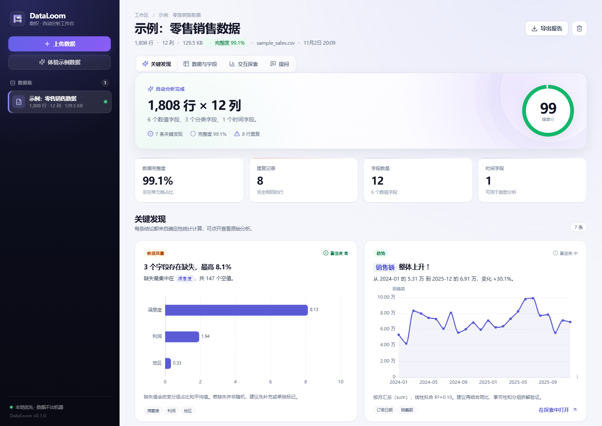
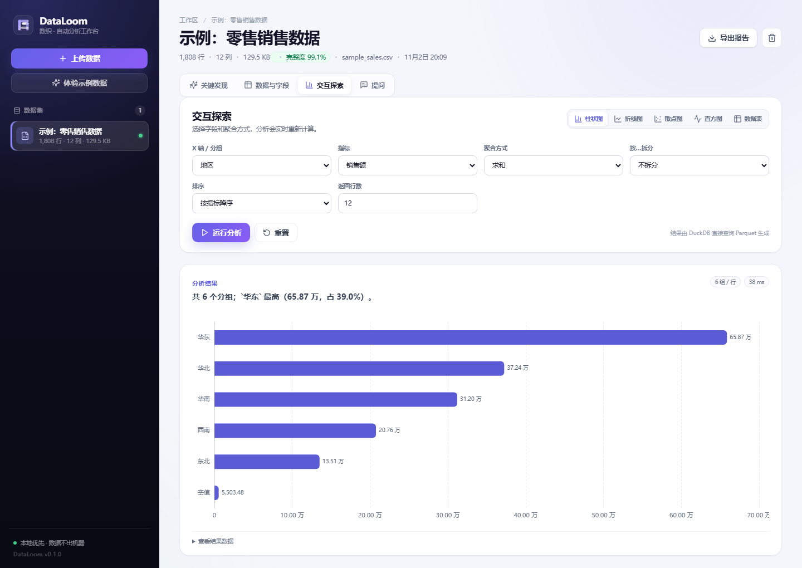
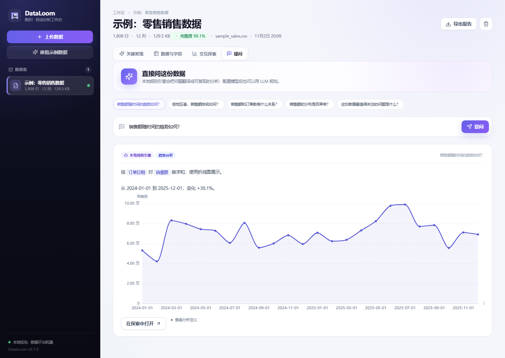
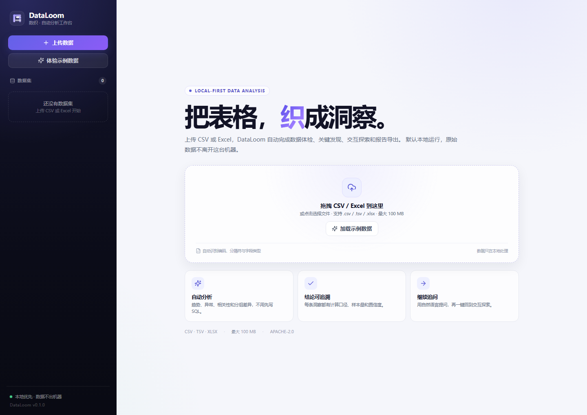
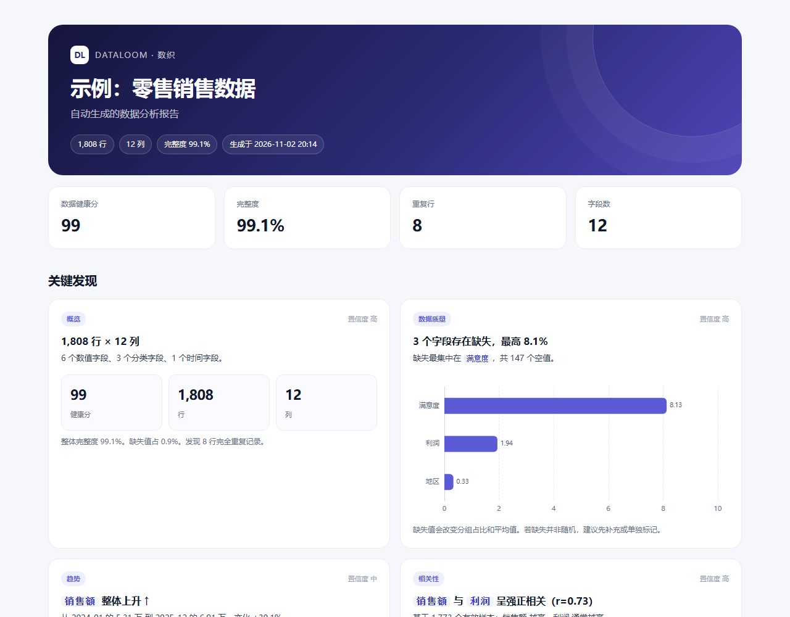
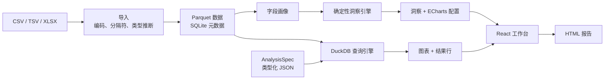

<div align="center">
  
  <h1>DataLoom · 数织</h1>
  <p><strong>上传一份表格，几十秒得到一份可审计、可追问、可导出的数据分析报告。</strong></p>
  <p>本地优先 · 无需写 SQL · 确定性洞察 · 一键导出</p>

  <p>
    
    
    
    
  </p>

  <p><a href="README.md">English</a> · <a href="docs/PUBLISHING.md">发布清单</a></p>
</div>



## 为什么做 DataLoom

大多数“AI 数据分析”只是给大模型套一个聊天框：图表看起来很漂亮，但你不知道数字算得对不对。

DataLoom 反过来做：

- **确定性引擎负责计算，AI 是可选项。** pandas 和 DuckDB 完成统计，LLM 只负责规划问题和写解释。不配置 API Key、不联网也能完整使用。
- **每条结论都可追溯。** 洞察卡片包含计算口径、样本量、证据和置信度；交互探索的配置是一份类型化的 JSON `AnalysisSpec`，不是不可复现的模型输出。
- **默认本地运行。** 上传、分析、导出都在自己的机器上完成。一条 Docker 命令即可启动。

## 能做什么

- 拖拽上传 **CSV / TSV / XLSX**，自动识别编码、分隔符、表头和字段类型。
- 自动生成数据画像：缺失值、重复行、唯一值、数值分布、IQR 异常值、时间范围、字段语义。
- 自动生成 **趋势、相关性、分组集中度、异常值、分布、数据质量** 洞察卡片。
- 交互探索支持 **柱状图、折线图、散点图、直方图和表格**，可按分类拆分、切换时间粒度、查看结果行。
- 用自然语言提问：本地规则引擎把问题翻译成经过校验的 `AnalysisSpec`；也可选接 OpenAI 兼容模型。
- 导出 **单文件 HTML 报告**，包含图表、字段画像和数据预览（图表通过 ECharts CDN 渲染，离线查看需联网）。
- Docker 单容器运行，数据持久化到 `./data`。

<details>
<summary><strong>更多截图</strong>（交互探索、提问、空状态）</summary>

| 交互探索 | 自然语言提问 |
| --- | --- |
|  |  |

| 空状态 | 导出报告 |
| --- | --- |
|  |  |

</details>

## 快速开始

### Docker（推荐）

```bash
git clone https://github.com/zzcdall/dataloom.git
cd dataloom
docker compose up --build
```

打开 <http://localhost:8000>，点击「体验示例数据」。

### 本地开发

需要 Python 3.10+、Node.js 20+。

```bash
python -m venv .venv
source .venv/bin/activate          # Windows: .venv\Scripts\activate
pip install -e "backend[dev]"
```

终端 1，启动 API：

```bash
uvicorn app.main:app --app-dir backend --reload
```

终端 2，启动前端：

```bash
cd frontend
npm install
npm run dev
```

打开 <http://localhost:5173>。Vite 会把 `/api` 代理到 `127.0.0.1:8000`。

### 示例数据

`examples/sample_sales.csv` 是一份确定性的合成零售数据，包含 1,808 行、缺失值、异常值和少量重复行。运行 `python examples/generate_sample.py` 可重新生成。

## 工作原理



核心数据结构只有两个：

```json
{
  "chart_type": "bar",
  "x": "地区",
  "y": "销售额",
  "aggregation": "sum",
  "group_by": null,
  "time_grain": "month",
  "filters": [],
  "sort": "y",
  "limit": 12
}
```

- **`AnalysisSpec`** 描述一张图或一张表。执行前会校验字段是否存在于画像中，标识符加引号，筛选值参数化，再编译成 DuckDB SQL。
- **`Insight`** 包含结论、证据、置信度、图表配置，以及复现这张图所需的 `AnalysisSpec`。

### 洞察检测器

| 检测器 | 关注点 |
| --- | --- |
| 概览 | 行列数、完整度、字段语义构成 |
| 缺失值 | 各字段缺失率排序 |
| 重复行 | 完全重复记录及占比 |
| 常量字段 | 只有一个取值的字段 |
| 异常值 | 数值字段的 IQR 异常值，箱线图呈现 |
| 趋势 | 按时间粒度聚合、线性拟合与变化率 |
| 相关性 | 超过阈值的 Pearson 配对，散点图 + 拟合线 |
| 分组集中度 | 头部占比、前三占比、分组数 |
| 分布 | 偏度、均值与中位数偏离，直方图呈现 |

## API

交互式文档：<http://localhost:8000/docs>。

| 方法 | 路径 | 用途 |
| --- | --- | --- |
| `GET` | `/api/health` | 健康检查与版本 |
| `GET` | `/api/datasets` | 数据集列表 |
| `POST` | `/api/datasets` | 上传 CSV/TSV/XLSX（`multipart/form-data`） |
| `POST` | `/api/demo` | 加载内置示例数据 |
| `GET` | `/api/datasets/{id}` | 画像、洞察、建议问题 |
| `GET` | `/api/datasets/{id}/preview` | 前 N 行 |
| `POST` | `/api/datasets/{id}/analyze` | 执行 `AnalysisSpec` |
| `POST` | `/api/datasets/{id}/ask` | 自然语言提问 |
| `GET` | `/api/datasets/{id}/export.html` | 下载 HTML 报告 |
| `DELETE` | `/api/datasets/{id}` | 删除数据与元数据 |

## 配置

复制 `.env.example` 为 `.env`，或在 shell / Compose 中设置。

| 变量 | 默认值 | 说明 |
| --- | --- | --- |
| `DATALOOM_DATA_DIR` | `./data` | Parquet 与 SQLite 存储目录 |
| `DATALOOM_MAX_UPLOAD_MB` | `100` | 最大上传大小 |
| `DATALOOM_CORS_ORIGINS` | 本地开发地址 | 允许的开发来源 |
| `DATALOOM_LLM_BASE_URL` | 空 | OpenAI 兼容接口地址 |
| `DATALOOM_LLM_API_KEY` | 空 | 可选规划模型的 Key |
| `DATALOOM_LLM_MODEL` | 空 | 可选规划模型的名称 |

三个 LLM 变量都配置后才会启用模型规划。模型只收到字段元数据和问题，返回 JSON 分析计划；计划仍会在本地校验和执行，不会收到原始行数据或生成 SQL。

## 目录结构

```text
dataloom/
├── backend/app/
│   ├── ingest.py       # CSV/XLSX 解析与类型推断
│   ├── profiling.py    # 字段画像与质量报告
│   ├── insights.py     # 确定性洞察检测器
│   ├── engine.py       # AnalysisSpec -> DuckDB SQL -> 图表
│   ├── planner.py      # 本地问题规划器
│   ├── llm.py          # 可选 LLM 规划器
│   ├── export.py       # 单文件 HTML 报告（ECharts CDN）
│   └── main.py         # FastAPI 路由与静态资源
├── frontend/src/       # React + ECharts 工作台
├── examples/           # 示例数据
├── docs/               # 截图与发布清单
├── Dockerfile
└── docker-compose.yml
```

## 安全与隐私

DataLoom 是本地优先的单用户工具，不自带登录与租户隔离；如果要暴露到公网，请放在带认证的反向代理之后。详细威胁模型见 [SECURITY.md](SECURITY.md)。

- 上传数据被视为不可信输入；字段名经过画像校验并加引号，筛选值使用参数绑定。
- LLM 规划器不能执行代码或 SQL，其输出与手写 `AnalysisSpec` 走同一套校验。
- 不配置 LLM 时，数据不会离开本机。

## 路线图

- [ ] 定时刷新与变化提醒（自动化层）
- [ ] 保存视图与可拖拽看板
- [ ] 筛选器 UI 与多 Sheet Excel
- [ ] PDF / PPTX 导出
- [ ] Postgres / MySQL / BigQuery 连接器
- [ ] 登录与团队空间（可选）
- [ ] 英文界面与 i18n

v0.1 明确不做：实时流、任意 Notebook 执行、几十种数据库连接器。先把上传到洞察这一条路径做扎实。

## 参与贡献

欢迎 Issue 和 PR。请先阅读 [CONTRIBUTING.md](CONTRIBUTING.md)，并保持确定性核心没有隐藏副作用。

```bash
python -m pytest backend/tests
cd frontend && npm run build
```

## 许可证

[Apache-2.0](LICENSE)。许可证覆盖代码；名称与 logo 属于项目标识。

